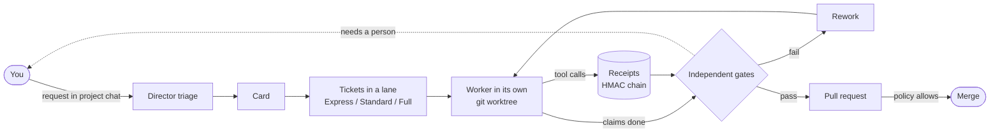
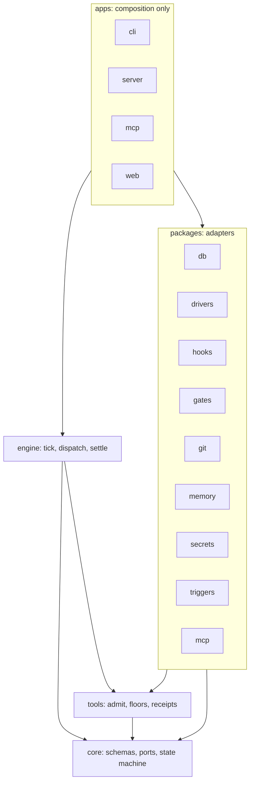

<div align="center">

<!-- LOGO: docs/assets/logo.png (to be provided) -->

<!-- BANNER: docs/assets/banner.png (to be provided) -->

# Forge

**An autonomous software-development organisation you run on your own machine.**

Ask for work in a chat. A Director plans it, AI coding agents build it in isolated git worktrees, independent gates verify it, and Forge opens the pull request.

[](https://github.com/vks-forge/forge/actions/workflows/ci.yml)


[](LICENSE)

[What it is](#what-is-forge) ·
[How it works](#how-it-works) ·
[Features](#features) ·
[Quick start](#quick-start-from-source) ·
[Architecture](#architecture) ·
[Status](#status-and-roadmap) ·
[Development](#development) ·
[Security](#security-model)

</div>

<!-- SCREENSHOTS: docs/assets/screenshot-board.png, screenshot-ticket.png (to be provided) -->

---

> [!WARNING]
> **Forge is in continuous, early development and is not safe to use yet.**
>
> - **Expect breaking changes.** APIs, the database schema, settings and commands change without notice or migration paths between versions.
> - **AI agents run code on your machine.** Workers execute commands and write files as your own user account, and are not yet isolated from it. They can read Forge's data folder, including its install token and stored secrets ([known limit](#known-limit-workers-are-not-yet-isolated-from-your-account)).
> - **Do not point it at repositories, machines or credentials you cannot afford to lose or expose.** Use a throwaway machine or VM and test repositories.
> - **Not production software.** It has not had an external security review, it is not published to npm, and Windows is the only supported platform today.

## What is Forge

Forge is software that a company, or a single developer, installs and runs on its own computer. You give it work in plain language. It turns that work into tickets, runs AI coding agents on them, checks the results with processes the agents cannot influence, and opens pull requests. You steer everything from a web interface on `127.0.0.1`.

Two parts do the work:

- The **Director** is a deterministic engine with short LLM steps. It triages requests, plans, dispatches, and decides what happens next.
- **Workers** are AI coding agents that run inside a harness you already have installed (Claude Code today). Each Worker gets its own git worktree.

The governing rule of the design (d-0001): **an agent's own report may trigger action, but it never proves anything.** Proof comes from independent processes: a receipt for every tool call, tests re-run by Forge, and diff checks. Only then does code move toward a merge.

## Who it is for

- A company or solo developer who wants AI agents to do real work across **many repositories**.
- People who want to set the rules (budgets, limits, which tools agents may use) in a UI, not by editing config files or code.
- Teams that want the work to stay on their own machine, under their own accounts.

One install is one company (d-0094). Accounts and roles for teams come later (d-0082).

## How it works



1. **Request.** You ask for work in the project chat.
2. **Triage.** The Director files it as a card and picks a lane for each ticket: Express, Standard or Full. A lane can only escalate, never relax (d-0006).
3. **Run.** A Worker runs in a fresh git worktree. Every tool call passes one policy door, `admit()`, and leaves a signed receipt.
4. **Verify.** Gate G1 compares what the Worker claims against the receipts, re-runs the project's checks, and inspects the diff and config files.
5. **Settle.** A failed gate sends the ticket back for rework (capped). A pass opens a pull request. Forge merges when policy allows, and asks you when it does not.

You can watch each Worker's live thread, answer its questions, and message it directly while it runs.

## Features

### Built today

| Area                  | What you get                                                                                                                                                                                             |
| --------------------- | -------------------------------------------------------------------------------------------------------------------------------------------------------------------------------------------------------- |
| **Director engine**   | Triage, dispatch, settle and verify steps; one `transition()` for every ticket state change; runs survive a restart; fair scheduling across projects                                                     |
| **Workers**           | Claude Code driver over ACP, with a `claude -p` CLI fallback; each run in its own git worktree                                                                                                           |
| **Verification**      | Gate G1: claims checked against receipts, test integrity, project checks by role for any language, diff and config guard                                                                                 |
| **Tool policy**       | Versioned tool catalogue in the database, lane grants, shell tokenizer and path floors, per-harness-build approval of native tools                                                                       |
| **Receipts**          | HMAC-chained record of every tool call, written by Forge's hooks and verified across restarts                                                                                                            |
| **Many projects**     | One server runs many projects; each has its own settings overrides and its own memory                                                                                                                    |
| **Project memory**    | Decisions, rejected approaches and outcomes kept as markdown in a private git repo per project; the Director reads them                                                                                  |
| **GitHub**            | GitHub App as the git host (branches, PRs, checks, merge); add an App connection per account or organisation in Settings                                                                                 |
| **Secrets**           | Windows DPAPI encrypted store; Workers get an allowlisted environment, not the server's                                                                                                                  |
| **Web control room**  | First-run wizard, new-project flow, Home with stats, Inbox, Board (Cards and Tickets), Card page with Director chat, Ticket page with live Worker thread, Runs, Cost, Memory, project and Forge settings |
| **Local-only access** | Loopback bind, install token, one-time browser sign-in link                                                                                                                                              |
| **CLI**               | `forge start`, `open`, `status`, `stop`, `secret wrap`                                                                                                                                                   |

### On the roadmap

- Worker isolation under a separate low-privilege OS account (next, d-0117)
- One-click GitHub App creation through the manifest flow (d-0084)
- GitHub Issues as a way to ask for work, and an Issues page
- Director actions to pause, restart and re-plan tickets; a plan-approval step for Plan cards
- Agents and pipelines as an editable engine
- Other harnesses (Codex, OpenCode)
- macOS and Linux as supported platforms
- Packaging and publishing

## Quick start from source

Forge is not on npm yet. The planned install is `npm i -g vks-forge` (d-0091, d-0099); **that command does not work yet.**

### Prerequisites

| Need                                                                               | Version                                 |
| ---------------------------------------------------------------------------------- | --------------------------------------- |
| [Node.js](https://nodejs.org)                                                      | 24 or newer                             |
| [pnpm](https://pnpm.io)                                                            | 12.6.0 (pinned in `package.json`)       |
| [git](https://git-scm.com)                                                         | on your `PATH`                          |
| [Claude Code](https://docs.claude.com/en/docs/claude-code/overview) CLI (`claude`) | installed and signed in; Workers run it |
| Windows                                                                            | the supported platform today            |

### Run it

```bash
git clone https://github.com/vks-forge/forge.git
cd forge
pnpm install
pnpm build
node apps/cli/dist/main.js start
```

`start` runs the server in the background, serves the web UI, and opens your browser already signed in through a one-time link. Run it from the checkout (or set `FORGE_ROOT`). The server log is `<data folder>/logs/server.log`.

```bash
node apps/cli/dist/main.js status   # running? pid, port, uptime, version
node apps/cli/dist/main.js open     # a fresh one-time sign-in link
node apps/cli/dist/main.js stop     # clean shutdown
node apps/cli/dist/main.js start --no-open   # start without opening a browser
```

The data folder defaults to `%LOCALAPPDATA%\Forge` and holds the database, secrets, run folders, worktrees and per-project memory (d-0098).

## Using Forge

1. **First-run wizard.** Check the data folder, the installed harness and its login, and connect GitHub by adding your GitHub App's details. One-click App creation is on the roadmap (d-0084).
2. **Add a project.** Point Forge at a git repository on your machine. Forge checks the folder, detects languages and checks, and runs them once. Support for any folder, with or without git, is in progress (d-0124).
3. **Ask for work.** Describe what you want in the project chat. The Director files a card and tickets.
4. **Watch and steer.** Use the Board (Cards and Tickets views), open a Card to talk to its Director, open a Ticket to follow the live Worker thread, answer questions and message the Worker.
5. **Tune it.** Harnesses, GitHub, limits and per-project settings live in Settings and are stored in the database, not in files.

<details>
<summary><strong>Key concepts</strong></summary>

| Term     | Meaning                                                                    |
| -------- | -------------------------------------------------------------------------- |
| Company  | one install; owns default settings, GitHub connections, harnesses          |
| Project  | one repo + local folder + settings overrides + its own memory              |
| Ticket   | a unit of work, id `<PREFIX>-<n>`, moves through one state machine         |
| Lane     | process weight: Express, Standard, Full; only escalates                    |
| Director | the engine + LLM steps that triage, plan, dispatch, steer                  |
| Worker   | an AI agent run in a harness, inside its own worktree                      |
| Harness  | the user-installed agent CLI (Claude Code now; Codex, OpenCode later)      |
| Receipts | HMAC-chained record of every tool call, written by Forge's hooks           |
| Gates    | independent checks (G1 built: claims vs receipts, tests, diff, config)     |
| Memory   | per-project decisions, rejected approaches, outcomes, read by the Director |

</details>

## Architecture

Forge is a TypeScript pnpm monorepo on Node 24 with SQLite storage. Dependencies point inward, and the rule is enforced by lint (`no-restricted-imports`), so a wrong import is a build error.



- `core` is pure: types, zod schemas, ports and the ticket state machine. No IO.
- `tools` is the policy ring: one `admit()` for tool calls, floors, grants, receipts.
- `engine` is orchestration over ports. No IO.
- Adapter packages implement the ports and never import each other.
- `apps/*` only wire config to adapters to engine. They are the only place that opens a database, spawns a server or reads env.

<details>
<summary><strong>Packages and apps</strong></summary>

| Path                | What it is                                                                                                        |
| ------------------- | ----------------------------------------------------------------------------------------------------------------- |
| `packages/core`     | Schemas, the ticket state machine, lane triage, ids, typed errors and the ports every adapter implements          |
| `packages/tools`    | Tool policy as pure functions: catalogue, lane grants, shell tokenizer, `admit()`, hash-chained receipts, budgets |
| `packages/engine`   | The Director's engine: tick, dispatch, settle and the model steps                                                 |
| `packages/db`       | SQLite (WAL) and in-memory storage and receipt log                                                                |
| `packages/drivers`  | `WorkerDriver` implementations, one folder per harness (Claude Code today), plus the Claude `DirectorLLM`         |
| `packages/hooks`    | Receipt ingress: answers a Worker's hook posts, decides with `admit()`, appends signed receipts                   |
| `packages/gates`    | The verification plane; G1 is built, G2 to G6 are not                                                             |
| `packages/git`      | Worktree manager and `GitHost` adapters (local bare repo, GitHub App)                                             |
| `packages/memory`   | Project memory in a private git repo per project, with a Director-only writer                                     |
| `packages/secrets`  | `SecretStore` adapters: Windows DPAPI and in-memory                                                               |
| `packages/triggers` | Ticket sources that feed the Director (chat today)                                                                |
| `packages/mcp`      | The `forge` MCP server, the only Forge tools a Worker gets                                                        |
| `apps/server`       | The server process: HTTP and SSE API on `127.0.0.1`, engine tick, hook ingress, serves the web UI                 |
| `apps/cli`          | The `forge` command                                                                                               |
| `apps/mcp`          | The `forge-mcp` stdio process, one per run                                                                        |
| `apps/web`          | The React control room                                                                                            |

</details>

Rules and design:

- Code rules: [`.claude/rules/code.md`](.claude/rules/code.md)
- Design docs: [`docs/design/`](docs/design/) (director core, execution plane, verification plane, tool system, memory system, UI screen map, build plan)
- Product description and progress log: [`PRODUCT.md`](PRODUCT.md)
- Project decisions (d-NNNN): [`.forge/memory/decisions/`](.forge/memory/decisions/)

## Status and roadmap

Status as of 2026-10-16. The full progress log is in [`PRODUCT.md`](PRODUCT.md).

| Step | What                                                                | Plan                        |
| ---- | ------------------------------------------------------------------- | --------------------------- |
| Done | Realign the existing code (batches B0 to B14)                       | `docs/design/build-plan.md` |
| Now  | Worker isolation: separate low-privilege account for Workers/checks | d-0117                      |
| P2   | Onboarding: GitHub manifest flow, language detection, Director chat | change map W4, W5, W9       |
| P3   | Control room UI: every setting and flow on screen                   | change map W12, W14, W15    |
| P4   | First release on Windows as `vks-forge`                             | change map W16, W17, W20    |
| P5   | GitHub Issues intake, agents and pipelines engine, macOS/Linux, exe | change map W13, W19         |

The change map is [`docs/design/product-shape-change-map.md`](docs/design/product-shape-change-map.md).

## Development

```bash
pnpm install          # install workspace dependencies
pnpm build            # clean, tsc -b, then build the web app
pnpm check            # typecheck, lint, format check, tests related to your change
pnpm check --heavy    # the same, plus the slow heavy test project
pnpm test             # full suite with coverage (what CI runs)
pnpm typecheck        # tsc -b
pnpm lint             # eslint
pnpm format           # prettier --write
pnpm format:check     # prettier --check
```

- `pnpm check` is the local gate. It runs only the tests that touch the files you changed, with no coverage. Other options: `--all`, `--no-tests`, `--base=<ref>`, `--dry`.
- Vitest has three projects: `unit`, `web` (React and jsdom) and `heavy` (tests that spawn git, node children or a server). Run one with `pnpm test:unit`, `pnpm test:web` or `pnpm test:heavy`.
- Web end-to-end tests are Playwright specs in `apps/web/e2e/`.
- `pnpm probes` runs live probes against a real harness. They skip themselves unless `FORGE_PROBES=1`.
- CI ([`.github/workflows/ci.yml`](.github/workflows/ci.yml)) runs typecheck, lint, format check and the full suite on Windows, macOS and Linux for pushes to `main` and pull requests that change code.

## Security model

- **Local only.** The server binds to loopback and refuses any other host. Requests need the install token or a browser session, and the `Host` and `Origin` headers are checked. There is no CORS (d-0093).
- **The page never holds the install token.** `forge start` and `forge open` get a single-use code (60 seconds) and the browser trades it once for an `HttpOnly`, `SameSite=Strict` session cookie.
- **The install token file** is created in the data folder; on Windows its ACL is cut to the current user.
- **One policy door.** Every tool call goes through `admit()`, which fails closed: unknown input is denied.
- **Receipts.** Each run has its own HMAC secret; receipts are chained and verified, including across restarts.
- **Secrets** are encrypted at rest with Windows DPAPI. Workers get an allowlisted environment, not the server's.

### Known limit: Workers are not yet isolated from your account

Workers and project checks run as your own Windows account. Code a Worker writes and runs, such as a test or a script, can read Forge's data folder, including the install token and secrets. The tool policy guards tool arguments, not the operating system. Real isolation, with a separate low-privilege account or WSL2/container, is the next work item (d-0117). Until then, run Forge only on a machine and with repositories you are willing to expose to the agents you configure.

Please report security problems privately to the maintainers rather than in a public issue. A formal security policy file has not been written yet.

## Contributing

Contributions are welcome in principle, but a `CONTRIBUTING` guide has not been written yet. Before opening a pull request:

- Read [`.claude/rules/code.md`](.claude/rules/code.md). It is binding: layers point inward, one interface with many adapters, zod schemas as the source of truth, one door per policy path, a header comment on every file, a README per package.
- Run `pnpm check` and make sure it is green.
- Keep [`PRODUCT.md`](PRODUCT.md) and the affected package README current in the same change.

## License

Forge is released under the [MIT License](LICENSE). It is provided "as is", without warranty of any kind.
