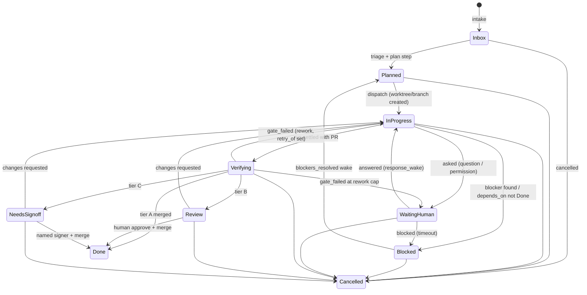

# Director core — engine, state, intake, steering

Status: proposed, 2026-10-12
Depends on: [`v1-decisions.md`](v1-decisions.md), [`execution-plane.md`](execution-plane.md), [`memory-system.md`](memory-system.md)
Evidence: OpenAI Symphony SPEC, Paperclip durable-continuation scheduler, OpenHands SDK event log, Pi rpc steering, Claude Agent SDK streaming input, LangGraph interrupt semantics (URLs in §9).

## 1. Verdict

The Director is a **deterministic scheduler with finite, stateless LLM steps**.
Heartbeat mechanics from Paperclip (durable wake requests, continuation kinds,
coalescing) provide crash durability; the engine, not the agents, owns the
ticket state machine.

Every system that tried a pure "orchestrator LLM mode" retired it: Kilo
deprecated orchestrator mode in favour of on-demand delegation, Roo Code is
archived, Plandex shut down. Symphony and Paperclip, the two that run in
production, both use a scheduler tick with finite runs.

## 2. Engine tick

One process, one SQLite writer (WAL mode), tick every 30 s (min 10 s), plus an
immediate tick on any intake event or run event. Each tick, in order:

1. **Reconcile** running work: stall detection against last-event time, dead
   process detection, settle finished runs (git diff, `outcomes/` record, token
   revoke).
2. **Refresh** ticket state from settled results and answered interactions.
3. **Dispatch** ready tickets within a global slot limit and per-state limits
   (`max_concurrent_by_state`, e.g. at most 1 Verifying per Epic).

All state mutation happens inside the tick under a single writer. UI reads are
projections. Nothing outside the tick writes ticket state.

## 3. State store

Hybrid, following OpenHands SDK: mutable rows for the things the scheduler
decides on, an append-only event log for everything that happened.

```
projects            id, slug, repo_origin, memory_repo, harness_defaults, tier_c_globs
tickets             id (public `<PROJECT>-<n>`, the primary key, d-0055), project, epic_id, title, body, status, status_version,
                    lane, tier_predicted, tier_actual, assignee_run_id, branch, worktree,
                    checkout_run_id, blocked_reason, created_by_intake
ticket_relations    from, to, kind (blocks | depends_on | related | supersedes | spawned_from)   ← the source of truth for parent and blockers
intake_events       id, source, kind, dedupe_key UNIQUE, actor, payload, received_at, ticket_id
wake_requests       id, ticket, reason, kind (retry | response_wake | delegated | monitor | continuation),
                    idempotency_key UNIQUE, coalesced_count, status, not_before
runs                id, ticket, harness, driver_version, session_ref, cwd, lane, started_at,
                    ended_at, status (starting | running | settling | settled | terminal result), usage_json, cost_usd,
                    error_family, retry_of, owner, pid, last_event_at, final_chain_hash, catalogue_hash, prompt_hash,
                    hook_registered_at
run_events          run, seq, ts, kind, payload           ← append-only, replayable
run_inbox           run, seq, mode (steer | follow_up | interrupt), author, text, delivered_at
interactions        id, ticket, run, kind (question | plan_confirm | permission), payload,
                    status, asked_at, answered_at, timeout_at, answer
gate_results        run, gate (G1..G6 | BR), status, report_ref, started_at, ended_at
tool_decisions      per-call decision receipt, HMAC-chained   ← written by hooks, read by G1
tool_effects        per-call effect receipt linked by decision_id, HMAC-chained (columns in tool-system.md §10)
```

Rules:

- `tickets.status_version` increments on every transition; a transition
  carries the version it read (compare-and-set). Stale writers lose.
- `run_events` is the UI and replay source. It is never the scheduler's source
  of truth.
- Harness owns the transcript. We store `session_ref` and resume through it
  (see `execution-plane.md` §7).
- **Relations have one source of truth: `ticket_relations`.** `Ticket.parent` and
  `Ticket.blocked_by` are not columns; the storage repository derives them on every read
  (parent = the first `spawned_from` edge out of the ticket; blocked_by = its `depends_on`
  targets plus the sources of `blocks` edges into it). A ticket patch cannot carry them,
  `tickets.insert` records a seeded parent or blocker as edges, and every later change goes
  through `ticketRelations.add/remove`. Two copies would disagree, and a ticket could start
  while a blocker is still open.
- **Resume creates a new `runs` row.** A resumed (or retried) run is a new row whose
  `retry_of` names the run it continues; a run with `ended_at` is never reopened (storage
  refuses to clear `ended_at` or to move an ended run back to `starting` / `running`). The
  first attempt's end time, status and `final_chain_hash` stay as evidence. "Is this run
  active?" is one rule everywhere (`isRunActive`: `starting` or `running`, no `ended_at`).
- Wake requests are idempotent on `(ticket, reason, key)`. A duplicate
  increments `coalesced_count` instead of inserting.
- **Automated re-wake cap:** at most 3 recovery wakes per ticket per hour, and
  a ticket whose run reported `done` is never re-woken by reconciliation; it is
  moved to Verifying. Paperclip's documented bug (a `done` run rejected by its
  classifier and re-woken every 30 s forever) is the thing this prevents.
- Invariant, checked every tick: every open assigned ticket has a live run, a
  durable reason to wait (`interactions` pending or `wake_requests.not_before`
  in the future), or a visible blocking status. Violations surface in the
  control room, never silently retried.

## 4. Ticket state machine



As implemented (`packages/core/src/domain/state-machine.ts`): `cancelled` is accepted
from every non-terminal status (inbox, planned, in_progress, blocked, waiting_human,
verifying, review, needs_signoff); `done` and `cancelled` are terminal and reject all
events. `asked` and `answered` are the events behind the WaitingHuman edges. A
`gate_failed` beyond `MAX_AUTO_REWORKS` (2) parks the ticket in WaitingHuman with a
`blocked_reason` instead of looping. Tier A stays in Verifying after `gate_passed` until
the `merged` event.

Transitions are pure functions `(ticket, event) → ticket'` with no LLM inside.
The LLM is called by *steps* that produce events.

## 5. LLM steps

Each step is a finite call with a schema-validated output. Invalid output is a
rejected step (logged, retried once with the validation error), never a
partial state write.

| Step | Input | Output (schema) | Lane |
|---|---|---|---|
| `triage` | intake payload, memory slice (`decisions/`, `rejected/`), tier-C glob hits, predicted files | `{lane, confidence, predicted_files[], questions[]}` | all |
| `clarify` | triage output, user answers so far | `{questions[] | done}` | Full; Standard only if confidence < 0.7 |
| `plan` | clarified intake, memory, code graph summary | `{tickets[{title, body, predicted_files, relations, tier_predicted}]}` | Standard, Full |
| `dispatch_prompt` | ticket, memory slice, wake delta, handoff | rendered prompt (string) + tool exposure | all |
| `steer_reply` | user message on a ticket thread, run state | `{mode: steer|follow_up|interrupt|none, text}` | all |
| `rework_brief` | gate report, prior run summary | `{approach: retry|different, brief}` | all |
| `epic_summary` | all child outcomes | summary + `proposed/` memory candidates | Standard, Full |

Deterministic overrides run before and after every step: tier-C glob match
forces Full; `predicted_files > 6` forces at least Standard; a `rejected/` hit
in a plan rejects the step with the record quoted.

## 6. Lane triage: start light, escalate on signal

No production system scores task size up front successfully. The working
pattern is: start in the lightest plausible lane and escalate on observed
signals. `execution-plane.md` §2 defines the lanes; this is the decision rule.

1. Deterministic pre-check: tier-C glob hit, new dependency, `blocks`
   relations, or user "full" → **Full**. Done.
2. Otherwise `triage` step proposes a lane with confidence.
3. User hint "quick" + no pre-check hit → **Express** regardless of confidence.
4. Confidence < 0.7 → one lane up.
5. **Escalation signals during the run** (checked each tick from `run_events`
   and the live diff): files touched > lane cap, a path matching tier-C globs,
   a G2 violation, a Worker calling `report_blocked` or asking to delegate,
   two stalls. Any signal moves the ticket up one lane; the current run
   continues, but the exit requirements change (more gates, review tier).
6. Never move down.

Metric: escalation rate per lane. Target < 30% for Express.

## 7. Intake

One envelope, one table, one pure mapping function:

```ts
interface IntakeEvent {
  source: "chat" | "webhook" | "cron" | "telemetry" | "bug_report";   // v1: chat only
  kind: "new_request" | "reply" | "command";
  dedupe_key: string;        // chat: message id; cron: `cron:<job>:<slot>`; webhook: delivery id
  actor: { type: "user" | "system" | "external"; id: string };
  project: string;
  payload: unknown;          // raw, quarantined; never forwarded to a Worker verbatim
  received_at: string;
}
```

`mapIntake(event) → CreateTicket | CommentTicket | Wake | Ignore`. The Director
never sees adapter specifics. Adding a webhook adapter later is a new emitter
of the same envelope and nothing else changes.

## 8. Live steering and blocking questions

### User → Director

Each user message on a project or ticket thread is an intake `reply` event and
triggers an immediate tick. The `steer_reply` step decides whether it is a
steering message for a running Worker, a Director-level instruction (lane
override, cancel, re-plan), or a memory candidate (`decisions/`, confirmed
in-thread with one click).

### Director/User → Worker

A `run_inbox` row per message with a delivery mode, mapped to the harness's
native primitive. Pi's model is the reference:

| Mode | Semantics | Claude Agent SDK | Codex app-server | OpenCode | Pi rpc |
|---|---|---|---|---|---|
| `steer` | deliver after current tool calls, before next model call | streaming-input queue (`streamInput`) | `turn/steer` | `prompt_async` on same session | `steer` |
| `follow_up` | deliver only when agent is idle | queued user message after `result` | next `turn/start` | `prompt_async` after idle | `follow_up` |
| `interrupt` | stop now, keep session | `interrupt()` | `turn/interrupt` | `abort` | `abort` |

Default for user chat is `steer`. `interrupt` requires an explicit user action
in the UI because it loses in-flight tool work. Delivery is recorded in
`run_inbox.delivered_at` and echoed in `run_events`.

### Worker → Human (blocking)

Never stall the run on a question. A Worker's `ask_director` tool or a
permission request outside the allow-list creates an `interactions` row, moves
the ticket to **WaitingHuman**, and the run either:

- stays open with the harness's pending callback (Claude `canUseTool` may stay
  pending; OpenCode permission endpoint; ACP `request_permission`) when the
  expected wait is short (< 10 min), or
- exits via a deferred permission (Claude PreToolUse hook returning `defer`)
  with the session persisted, and resumes on `response_wake` when answered.

The Director answers from the allow-list automatically where policy permits;
everything else lands in the control room's "Needs you" pane with a timeout
(default 4 h, then Blocked with reason).

## 9. Sources

- Symphony SPEC §7–8, §10.5, §11, §14.3, §16 — https://raw.githubusercontent.com/openai/symphony/main/SPEC.md
- Paperclip durable-continuation scheduler — https://raw.githubusercontent.com/paperclipai/paperclip/master/doc/architecture/durable-continuation-scheduler.md
- OpenHands SDK event log and conversation state — https://docs.openhands.dev/sdk/arch/events, https://docs.openhands.dev/sdk/arch/conversation
- Pi rpc commands (steer / follow_up / abort, `agent_settled`) — https://raw.githubusercontent.com/badlogic/pi-mono/main/packages/coding-agent/docs/rpc-commands.md
- Claude Agent SDK streaming input, `interrupt()`, `canUseTool`, deferred permissions — https://docs.claude.com/en/docs/agent-sdk/typescript, https://docs.claude.com/en/docs/agent-sdk/user-input
- LangGraph interrupt/resume idempotency constraints — https://docs.langchain.com/oss/python/langgraph/interrupts
- Kilo orchestrator-mode deprecation, Roo Code archive, Plandex shutdown: GitHub repo status as of 2026-10-12 (unverified beyond repo metadata)
