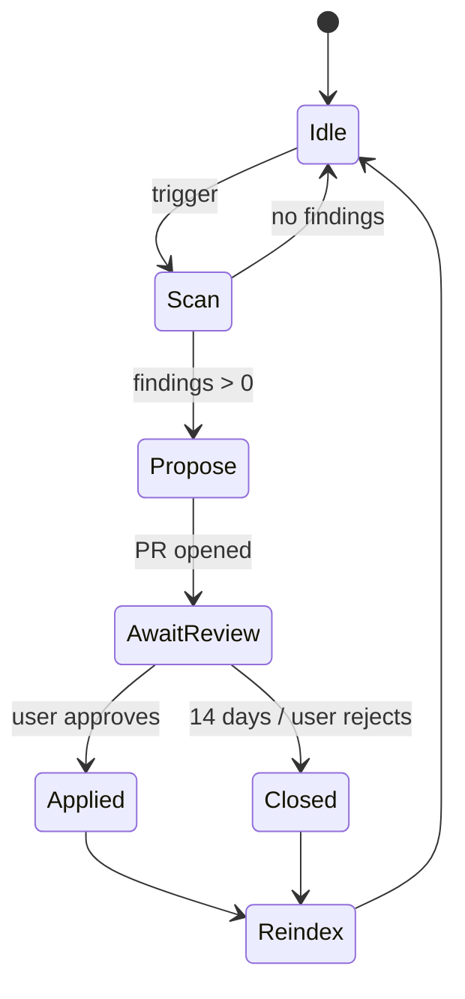

# Director memory system — design spec

Status: proposed, 2026-10-12
Depends on: [`v1-decisions.md`](v1-decisions.md)
Evidence: source reads of OpenClaw (`extensions/memory-core`, `docs/concepts/memory*.md`,
`docs/concepts/dreaming.md`) and Paperclip (`packages/db/src/schema/*`,
`packages/plugins/plugin-llm-wiki`, `doc/execution-semantics.md`), plus the
literature cited in §10.

## 1. Problem

The Director plans every Epic from scratch unless it remembers, per project:

- decisions and constraints the user gave in chat ("use the existing HMAC helper");
- approaches already rejected and why;
- what happened to past tickets: which gates failed, which tier they landed in, what the cause was;
- rules that emerged from repeated outcomes.

Workers are ephemeral (container or harness session per ticket) and must not
carry memory between tickets. Memory therefore belongs to the Director, scoped
per project, and must be safe against an agent writing something wrong once and
reading it forever.

## 2. Verdict

**Git-backed markdown per project, SQLite as a rebuildable index, one gated
writer (the Director), workers read-only, and an event-triggered, propose-only
janitor.** No vector database, no graph framework, no always-on memory agent.

Why this and not a framework:

- Chat-recall benchmarks disagree with each other (full-context wins LoCoMo by
  4–6 points; Zep's graph wins LongMemEval by 11). No architecture dominates.
- The only coding-specific benchmark found (VibeMemBench) reports 11 of 12
  solver+memory pairings scoring *below* the memory-off baseline. Only direct
  injection of verified experience gained (+1.1 to +4.5).
- Letta's own measurement: plain files plus an agent that can grep them scored
  74% on LoCoMo. Agent capability dominated the retrieval mechanism.
- Git gives diff, blame, revert, branches and human review for free, which is
  exactly the approval workflow we need for memory writes.

## 3. Principles

1. **Markdown is truth. SQLite is a cache.** The index can be deleted and
   rebuilt from the files at any time.
2. **One writer.** Only the Director process writes to a project's memory repo.
   Workers return structured results; a deterministic hook records them.
3. **Supersede, never delete or merge.** A changed decision gets a new record
   that points at the old one. Automatic merge is error-prone (open-domain merge
   recall ≤ 0.062 in the one study that measured it) and silently destroys the
   current value.
4. **Provenance is immutable and lives outside the prose.** `source`, `author`,
   `origin` are set at write time and survive every consolidation. A janitor
   that summarizes worker prose would launder an untrusted origin into a
   trusted one; it is forbidden from doing so.
5. **User statements are authoritative; agent inferences are proposals.**
6. **Recalled memory is data, not instructions.** It is injected into prompts
   as quoted context with its provenance visible. Executing recalled text as
   instructions is the documented memory-poisoning path (0–95% attack success
   depending on model; structural data-only handling reached 0%).
7. **Small always-loaded set, everything else on demand.** Hard caps with
   visible truncation.
8. **Memory does not enforce policy.** Gates, ledger tiers and the egress proxy
   enforce. Memory only informs.

## 4. Storage layout

One git repository per project, outside the product repo:

```
.factory/
  memory/
    <project-slug>/              git repo, Director-only write, main protected
      MEMORY.md                  index + pinned summary, always loaded, ≤ 200 lines / 25 KB
      decisions/                 user decisions and constraints
        d-0001-billing-grandfather.md
        d-0002-reuse-hmac-helper.md
      rejected/                  approaches rejected, with reason
        r-0001-stripe-checkout-redirect.md
      outcomes/                  append-only episodic log, one file per ticket run
        2026-10/SF-142-3.md
      playbook/                  procedural rules distilled from repeated outcomes
        p-0001-migrations-need-backfill-ticket.md
      proposed/                  agent-inferred, NOT loaded until promoted
        x-0001-...
      JANITOR.md                 human-readable log of every janitor pass, diffs linked
      .index/
        memory.sqlite            rebuildable: FTS5 over bodies + structured columns
```

Rules:

- `decisions/` and `playbook/` changes land on `main` only through a reviewed
  commit (user approval in the control room, or Director writing a record whose
  `author: user`).
- `outcomes/` is append-only on `main`, written by the outcome hook.
- `proposed/` is where the Director and the janitor put anything inferred.
- `.index/` is gitignored.

Project identity: the slug maps to the product repo's normalized git origin.
Worktrees of the same repo share memory; forks do not (OpenClaw's rule).

## 5. Record schema

Every file in `decisions/`, `rejected/`, `playbook/`, `proposed/` is markdown
with YAML frontmatter. Fields the model can set are limited to `statement`,
`rationale`, `tags`, `importance`; everything else is set by the writer process.

```yaml
---
id: d-0002
kind: decision            # decision | rejected | playbook | proposed
statement: Reuse the existing HMAC verification helper for all inbound webhooks; do not write a new one.
rationale: One signature path to audit. User instruction in SF-142-3 thread.
source:                   # immutable
  type: chat              # chat | ticket | gate | janitor
  ref: msg_01HX...        # message id, ticket id, or gate report id
author: user              # user | director | janitor   (immutable)
origin: owner             # owner | agent | untrusted | system   (immutable; see §7)
status: active            # proposed | active | superseded | archived
valid_from: 2026-10-12T15:04:00Z
valid_to: null            # set when superseded
recorded_at: 2026-10-12T15:04:10Z
superseded_by: null       # id of the replacing record
supersedes: null
confidence: 1.0           # user-stated = 1.0; inferred starts ≤ 0.6
corroborations: []        # gate report ids that confirmed an inferred record
importance: 8             # 1–10, affects ranking only; decisions are pinned regardless
tags: [webhooks, security, authz]
pinned: true              # decisions/ default true; never subject to janitor scoring
---
Free-text body. May include the quoted user message.
```

Bi-temporal fields (`valid_from`, `valid_to`, `recorded_at`) follow Graphiti.
They let the Director answer "what was true when SF-130 was planned?" during a
post-mortem.

### Outcome record (`outcomes/`)

Written mechanically by the outcome hook. No free text from the Worker is
copied in; the Worker's own summary is linked by ticket thread id, not inlined.

```yaml
---
ticket: SF-142-3
epic: SF-142
run: run_7f3a
harness: claude-code         # or opencode | pi | codex | container
branch_strategy: worktree
tier_predicted: C
tier_actual: C
gates:
  G1: pass
  G2: pass
  G3: fail                   # hidden intent tests
  G4: skipped
  G5: skipped
  G6: skipped
failure_cause: "intent test webhook_replay_rejected: replay window not enforced"
rework_count: 1
superseded_run: run_6c01
files_touched: [apps/api/src/webhooks/stripe.ts, apps/api/src/lib/hmac.ts]
cost_usd: 1.84
tokens_in: 182000
tokens_out: 9400
duration_s: 611
decisions_in_context: [d-0002]
decisions_violated: []       # filled by G2 compiled-rule check when a decision has a rule
---
```

`decisions_violated` is the key quality signal: it is how we measure whether
memory is actually changing behavior (§9).

## 6. Write paths

| Event | Writer | Target | Status on write |
|---|---|---|---|
| User states a decision or constraint in chat (Director detects, user confirms in-thread with one click) | Director | `decisions/` | `active`, `author: user`, `confidence: 1.0` |
| User rejects a Director proposal with a reason | Director | `rejected/` | `active`, `author: user` |
| Director infers a lesson from an Epic ("this repo's migrations always need a backfill ticket") | Director | `proposed/` | `proposed`, `author: director`, `confidence ≤ 0.6` |
| Ticket run ends (any result) | Outcome hook (deterministic, no LLM) | `outcomes/` | append-only |
| Gate failure | Outcome hook | `outcomes/` (same file) | append-only |
| Janitor pass | Janitor | branch `janitor/<date>` only | PR against `main` |
| User edits any file in the control room | User | any | commit with `author: user` |

Workers never write. The harness session or container has no mount or token for
the memory repo. The only path from Worker to memory is the structured result
object consumed by the outcome hook.

Promotion of `proposed/` → `decisions/` or `playbook/`:

- user approves in the control room, or
- the record accumulates `corroborations` from ≥ 3 distinct gate reports across
  ≥ 2 Epics with zero contradicting outcomes, after which the janitor opens a
  promotion PR (still needs one click).

Pre-compaction flush (from OpenClaw): when the Director's own context is about
to be compacted, it runs a silent turn that appends candidate records to
`proposed/` before the summary is taken. Replayed or duplicate text is rejected
by hash.

## 7. Provenance and taint

`origin` is set by the writer process, never by the model:

- `owner` — came from the user (chat message, control-room edit).
- `agent` — Director's own inference in an interactive session.
- `untrusted` — anything written in a turn after a network-sourced tool
  result (web fetch, package registry, external API). Taint clears on the
  next user message. Structurally excluded from promotion.
- `system` — mechanical writers (outcome hook, janitor archival).

Promotion gates read `origin` from the SQLite column, not from the markdown, so
a model cannot promote its own record by editing frontmatter prose.

Secrets: the outcome hook runs a secret scanner over `failure_cause` and
`files_touched` before writing. Transcripts are never ingested into memory.

## 8. Read paths

### Director intake (every Epic)

Loaded in this order until the budget is hit; truncation is visible in the
control room ("12 of 14 decisions loaded"):

1. `MEMORY.md` (pinned summary, ≤ 200 lines).
2. All `decisions/` with `status: active` (pinned, never scored out).
3. All `rejected/` with `status: active`.
4. `playbook/` entries whose `tags` overlap the intake's tags, ranked by
   importance × recency.
5. The last 20 `outcomes/` for the same tags, as a compact table.

Budget: 25 KB total for 1–3, 15 KB for 4–5. Everything else is reachable through
a `memory_search` tool (FTS5 + structured filters) the Director may call.

### Worker dispatch (every ticket)

The Director assembles a ticket-scoped slice and the dispatcher injects it as a
fenced, labelled data block (not system prompt, not instructions):

```
<project-memory ticket="SF-142-3">
decisions (authoritative, author=user):
  - d-0002: Reuse the existing HMAC verification helper ... (webhooks, security)
rejected:
  - r-0001: Stripe Checkout redirect flow — rejected 2026-10-12, reason: ...
relevant past outcomes:
  - SF-130-2 (2026-09): G3 fail, cause: replay window not enforced
</project-memory>
```

Selection: records whose `tags` or `files_touched` overlap the ticket's planned
files, cap 10 records. Repo-overview prose is excluded on purpose; the
evidence says it costs tokens and does not improve coding outcomes, while
non-standard rules do.

Past failures are always injected *with* their cause. Injecting a similar task
without its failure label leads the agent to copy the wrong outcome.

### Ranking (for search and for `playbook/` selection)

`score = relevance × recency_decay × importance`, 30-day half-life on recency
for `outcomes/` only. `decisions/` and `rejected/` never decay and are never
scored out of the always-loaded set. This is the one deliberate departure from
OpenClaw, whose frequency-weighted promotion lets a rare but critical constraint
starve.

## 9. Janitor

Not always-on. Event-triggered, propose-only, cheap. Lazy, recurrence-triggered
consolidation cut token cost up to 87% with no accuracy loss in the one study
that measured it.

### Triggers

- An Epic closes.
- Every 25 ticket runs on the project.
- Director context compaction.
- Manual, from the control room.

### Allowed actions

| Action | Target | Lands on |
|---|---|---|
| Exact-duplicate detection (hash) | any | PR |
| Flag contradiction between two active records | `decisions/`, `playbook/` | PR with both records quoted, no resolution chosen |
| Mark `outcomes/` older than 180 days `archived` | `outcomes/` | direct commit (mechanical) |
| Propose promotion `proposed/` → `playbook/` when corroboration threshold met | `proposed/` | PR |
| Propose demotion of a `playbook/` rule whose tickets keep failing G2/G3 | `playbook/` | PR |
| Rebuild `.index/memory.sqlite` | index | local |
| Regenerate the summary block of `MEMORY.md` from active records | `MEMORY.md` | PR |

### Forbidden

- Merging two records into one.
- Deleting any record.
- Editing `statement`, `source`, `author`, `origin` of an existing record.
- Writing to `main` for anything except `outcomes/` archival and the index.
- Reading Worker transcripts or ticket threads directly. Its inputs are the
  structured records only.

### Output

A branch `janitor/<date>`, a PR with one commit per action, and an entry in
`JANITOR.md`. The control room shows pending janitor PRs in the "Needs you"
pane. Unreviewed PRs older than 14 days are closed, not merged.

### State machine



## 10. Safety

| Threat | Mitigation |
|---|---|
| Worker writes poisoned memory | Workers have no write path at all. |
| Director writes a wrong inference | Goes to `proposed/`, not loaded, needs approval or corroboration. |
| Network content laundered into a trusted record via summary | `origin: untrusted` set structurally; excluded from promotion; `source` immutable. |
| Stale decision keeps being applied | Supersession with `valid_to`; only `status: active` is loaded; `decisions_violated` surfaces conflicts. |
| Recalled memory executed as instruction | Injected as fenced data block with provenance; harness system prompt says memory is context, not command. |
| Janitor merges away the current value | Merge and delete forbidden; supersede only. |
| Memory bloat | Hard caps with visible truncation; archive by TTL on `outcomes/` only. |
| Two Director sessions write concurrently | Git: optimistic concurrency per file, atomic commit; conflict → second writer re-reads. |
| Secrets in memory | Scanner on outcome hook; transcripts never ingested. |

## 11. Evaluation

Chat-recall benchmarks do not measure what we care about. Track these per Epic
in the control room:

1. **Re-proposal rate** — Director proposed something present in `rejected/`.
   Target: 0.
2. **Decision-violation rate** — `decisions_violated` non-empty on a ticket
   whose dispatch slice contained the decision. Target: < 2%.
3. **Clarification repeat rate** — Director asked a question whose answer was
   already in `decisions/`. Target: < 5%.
4. **Playbook precision** — of tickets that followed a playbook rule, fraction
   that passed G2/G3 first try, vs. tickets that did not follow one.
5. **Memory cost** — tokens of memory injected per ticket, and janitor spend per
   month.

If (1)–(3) do not improve over the first 50 Epics, the memory system is not
earning its tokens and should be cut back to `decisions/` + `rejected/` only.

## 12. Implementation phasing

| Phase | Scope | Exit |
|---|---|---|
| M0 | Repo layout, record schema, `MEMORY.md` loader, `decisions/` + `rejected/` written from chat with in-thread confirmation. No index, no janitor. | Director intake shows loaded decisions; re-proposal rate measurable. |
| M1 | Outcome hook writing `outcomes/`; ticket-scoped Worker slice; `decisions_violated` from G2. | Decision-violation rate measurable. |
| M2 | SQLite FTS index + `memory_search` tool; `proposed/` with corroboration counting; pre-compaction flush. | Clarification repeat rate measurable. |
| M3 | Janitor: triggers, allowed actions, PR flow, `JANITOR.md`. | First janitor PR reviewed; no forbidden action possible by construction (tests). |
| M4 | Playbook promotion/demotion loop; eval dashboard in control room. | Playbook precision reported per Epic. |

## 13. What we took from whom

- **OpenClaw**: markdown truth + SQLite index; always-loaded curated files with
  char caps and visible truncation; provenance columns the model cannot write;
  taint after network tool results; supersession keys; consolidation accepted
  only with bounded loss, hash CAS, atomic rename and stored pre-image;
  `DREAMS.md` → our `JANITOR.md`; pre-compaction flush.
- **Paperclip**: ticket thread + keyed documents as the durable record;
  `blockers_resolved` wake; failure fingerprint with attempt cap; carry-forward
  summary on session rotation; wiki "patch, don't rewrite; reversed-by callout".
- **Letta MemFS / sleep-time agents**: git repo of markdown with root files
  loaded and subdirectories on demand; consolidation triggered after N steps or
  at compaction, with optional second review.
- **Graphiti**: bi-temporal validity on every record.
- **Devin Knowledge**: agent proposes, human accepts or dismisses.
- **Claude Code auto-memory**: `MEMORY.md` index + one file per topic, 200-line
  cap, scoped per repo and shared across worktrees.

## 14. Sources

- OpenClaw memory docs and `extensions/memory-core` (local clone, commit at HEAD on 2026-10-12)
- Paperclip `packages/db/src/schema`, `packages/plugins/plugin-llm-wiki`, `doc/execution-semantics.md` (local clone, commit 762d680)
- Letta MemFS — https://docs.letta.com/concepts/memfs
- Letta sleep-time agents — https://docs.letta.com/guides/agents/architectures/sleeptime
- Letta memory benchmark — https://www.letta.com/blog/benchmarking-ai-agent-memory
- Claude Code memory — https://code.claude.com/docs/en/memory
- Graphiti / Zep temporal graph — https://arxiv.org/html/2501.13956v1
- Mem0 paper and LoCoMo numbers — https://arxiv.org/html/2504.19413v1
- LongMemEval — https://arxiv.org/abs/2410.10813
- VibeMemBench (coding agents + memory) — https://arxiv.org/abs/2609.23570
- Context files do not improve coding agents — https://arxiv.org/abs/2602.11988
- Lazy consolidation (RecMem) — https://arxiv.org/abs/2605.16045
- Stale values and false merges — https://arxiv.org/abs/2610.10265
- Experience-following and error propagation — https://arxiv.org/abs/2505.16067
- Memory injection attacks (MINJA) — https://arxiv.org/abs/2503.03704
- Stored vs executed malicious memory — https://arxiv.org/abs/2605.08442
- Provenance laundering via summaries — https://arxiv.org/abs/2606.24322
- Collaborative multi-agent memory with provenance — https://arxiv.org/abs/2505.18279
- Devin Knowledge — https://docs.devin.ai/product-guides/knowledge
