# Self-improving skills and agents

Status: proposed, 2026-10-12
Decision: d-0019 (user). Depends on: [`execution-plane.md`](execution-plane.md) §5a, [`memory-system.md`](memory-system.md) §6–§9, [`verification-plane.md`](verification-plane.md), [`v1-decisions.md`](v1-decisions.md) ledger tiers.
Evidence: survey and papers in §12, read on 2026-10-12.

## 1. Verdict

Skills (`SKILL.md`), agent specs (YAML) and Director step prompts are text
components of the scaffold. The factory improves them the same way it improves
code: **observe outcomes, attribute them to a version, propose a diff, evaluate
on replay, gate by ledger tier, promote, monitor, roll back.** Nothing in the
loop applies its own change. Every run executes against a frozen snapshot of
the library, so an improvement never changes a run already in flight.

Three findings shape the design:

- Skill libraries evolved from traces plus evaluator feedback do improve
  later runs, but only when each iteration runs against a frozen snapshot and
  updates are evidence-guided, not free-form rewrites (From Interaction
  Traces to Persistent Skills).
- Self-evolving skill harnesses report efficiency gains, not safety gains. A
  skill describes behaviour; policy decides what becomes an action. Generating
  more skills widens that gap (Auto-Policy, not Auto-Skill). So improvements
  may change *how* a Worker works, never *what it is allowed to do*, without a
  human signature.
- Copied skills on GitHub almost never change from their source and a fix at
  the origin does not propagate (Skill Constellations). Versions, provenance
  and a registry are what make improvement possible at all; this is why
  `skills_registry` and `skill_usage` come back into v1 (x-0006).

## 2. What can improve, and by whom

| Component | File | Fields the loop may change | Fields that need Tier C (user signs) |
|---|---|---|---|
| Skill | `.forge/skills/<name>/SKILL.md`, `references/` | body prose, `description`, `references/*` | `allowed-tools`, anything under `scripts/`, new skill creation |
| Agent | `.forge/agents/<name>.yaml` | `system` prose, `skills[]` (only to add an already-approved skill) | `tools.allow/deny`, `lanes`, `model` |
| Director step prompt | `packages/core/prompts/<step>.md` | prose, few-shot examples | output schema, deterministic overrides |

Out of scope for this loop: lane thresholds, blast-radius weights, gate
thresholds. Those are numeric calibration from `outcomes/` tables
(`verification-plane.md` §7), done by a deterministic job, not by an LLM.

## 3. Signals

Collected mechanically per run and joined on `(component, version)`:

| Signal | Source | Strength |
|---|---|---|
| User correction while a skill was loaded (`run_inbox.mode = steer`, text classified as correction) | `run_inbox` + `steer_reply` classification | strongest; a human said the behaviour was wrong |
| Gate failure with cause (`G1` claim mismatch, test-diff, TDD-order; `G3` fail; `G4` finding) | `gate_results`, `outcomes/` | strong, deterministic |
| Rework count > 0 on a ticket | `outcomes/rework_count` | strong |
| Lane escalation during run | `run_events` | medium |
| `ask_director` question whose answer was in the skill or memory | `interactions` + match | medium (skill failed to communicate) |
| Cost / turns above lane median for the same skill | `runs.usage_json` | weak, efficiency only |
| Skill loaded but never referenced in transcript receipts | `tool_receipts` | weak; candidate for trimming |

Attribution rule: a signal counts against a skill only if the skill was in
the run's rendered HOME **and** the failing file or tool call overlaps the
skill's declared scope (`description` keywords, `references/` paths, or
`scripts/` names). Signals from runs tainted `origin: untrusted`
(`memory-system.md` §7) are excluded.

## 4. Data model (additions to `director-core.md` §3)

```
skills_registry     name, version, content_hash, signature, allowed_projects[], lanes[], parent_version, deprecated_at
agents_registry     name, version, content_hash, signature, allowed_projects[], lanes[], parent_version
skill_usage         run, component_kind (skill|agent|step), name, version, loaded_at, referenced (bool)
skill_signals       run, component_kind, name, version, signal (correction|gate_fail|rework|escalation|
                    unanswered_question|cost|unused), weight, evidence_ref
skill_proposals     id, component_kind, name, base_version, candidate_path, diff_hash, rationale,
                    signals_json, tier_required (A|C), status (proposed|evaluating|eval_failed|
                    awaiting_review|promoted|rejected|rolled_back), created_at, decided_at, decided_by
skill_evals         proposal, kind (static|replay), tickets_json, metrics_json, passed (bool), cost_usd
```

The registry and `skill_usage` are the registry-only database from
`execution-plane.md` §5a. Content stays in git; `candidate_path` points at a
branch `improve/<name>/<proposal-id>`.

## 5. The loop

```mermaid
stateDiagram-v2
  [*] --> Collect: trigger (Epic close | 25 runs | manual)
  Collect --> Attribute: signals joined to versions
  Attribute --> Idle: no component over threshold
  Attribute --> Reflect: component over threshold, not in cooldown
  Reflect --> Propose: improve_skill step emits diff + rationale
  Reflect --> Idle: step says no change
  Propose --> StaticEval: branch + PR opened
  StaticEval --> EvalFailed: lint / size / policy-widening
  StaticEval --> ReplayEval
  ReplayEval --> EvalFailed: regression on any metric
  ReplayEval --> AwaitingReview: Pareto improvement
  AwaitingReview --> Promoted: Tier A auto after 24 h with no objection, or user click; Tier C user signs
  AwaitingReview --> Rejected: user rejects (reason stored)
  Promoted --> Monitor: new version active for new runs only
  Monitor --> RolledBack: signal rate worse than parent over next 10 runs
  Monitor --> Idle: stable after 10 runs
  RolledBack --> Idle
  EvalFailed --> Idle
  Rejected --> Idle
```



Triggers are the janitor's (`memory-system.md` §9). Threshold to enter
Reflect: weighted signal sum ≥ 3 over the last 25 runs for that component,
with at least one strong signal. Cooldown: one open proposal per component;
no new proposal within 14 days of a rejection.

## 6. `improve_skill` step

A finite Director step (`director-core.md` §5). Runs on a model from a
different family than the Worker that produced the signals, read-only tools,
no network.

Input:
- current component text and version;
- the signals with evidence: the correction text, the gate report, the
  failing test name, the unanswered question. Never the full transcript;
- the last two rejected proposals for this component, with rejection reasons
  (so it does not re-propose them);
- the component's declared scope and the policy fields it may not touch.

Output schema:

```ts
{
  change: "none" | "edit",
  diff: string,                 // unified diff against base_version; ≤ 30% of lines
  rationale: string,            // which signals this addresses, one sentence each
  addresses: string[],          // skill_signals ids
  expected_effect: { metric: "gate_first_pass" | "rework_rate" | "correction_rate" | "unanswered_rate" | "cost", direction: "up" | "down" }[],
  touches_policy: boolean       // must be false unless the proposal is marked tier C
}
```

Deterministic checks after the step: diff applies cleanly; diff size cap;
frontmatter `allowed-tools` unchanged and `scripts/` untouched unless
`tier_required = C`; no URLs or fetched content inside the diff (taint);
`description` still under the harness length limits. Any failure rejects the
step with the reason, retried once.

## 7. Evaluation before promotion

**Static** (seconds): skill lint (frontmatter valid, size caps per harness,
no secrets), render on every driver's renderer without error, diff size.

**Replay** (minutes, costs money): pick k past tickets where this component
was loaded, half with bad signals and half clean, stratified by lane.
Re-run each in a throwaway worktree at the ticket's base commit with the
candidate version, same harness, same lane budget, Express-style gates
(G1 + G3). Compare to the recorded outcome of the parent version on the same
tickets.

- k = 4 for Tier A proposals, 6 for Tier C. Budget per proposal is capped at
  the lane's Express budget × k; a proposal that cannot be evaluated inside
  the cap is held, not promoted.
- **Acceptance is Pareto** (GEPA's rule): no tracked metric regresses on any
  replayed ticket class, and at least one of the metrics named in
  `expected_effect` improves. A candidate that fixes the bad tickets and
  breaks a clean one fails.
- Replay is non-deterministic. Run each ticket twice and require both runs
  to pass the gate for a "pass" (pass^2, from `verification-plane.md` §6).

Replay is the expensive part and the only honest one. Judge-over-transcript
("would this skill have prevented the failure?") is not used as a promotion
signal; it may be shown in the PR as colour.

## 8. Promotion, monitoring, rollback

- Tier A (prose, references, few-shot examples): auto-promote 24 h after
  eval pass if the user has not objected in Needs-you. Tier C (tools,
  scripts, lanes, model, new skill): user signs in Needs-you; nothing else
  can promote it.
- Promotion = merge to `main` of the skills repo, new `version`, new
  signature, `parent_version` set. In-flight runs keep their snapshot.
- Monitor the next 10 runs that load the new version. If the weighted signal
  rate is worse than the parent's trailing rate, roll back automatically
  (re-point registry to parent, keep the version in git as `deprecated_at`),
  write an `outcomes/` entry, and put the component in a 30-day cooldown.
- Every promotion and rollback is an `outcomes/` record and a line in
  `JANITOR.md`, so the memory system and this loop share one audit trail.

## 9. Agents and Director prompts

Same loop, different evals:

- **Agents**: replay as for skills. Additionally, a proposal that adds a
  skill to `skills[]` must name an approved skill version; a proposal that
  changes `tools`, `lanes` or `model` is Tier C by construction.
- **Director step prompts** (`triage`, `plan`, `dispatch_prompt`,
  `steer_reply`, `rework_brief`): eval is offline against the step's own
  recorded inputs and outputs. For `triage`, the metric is predicted lane
  vs. final lane on the last 50 tickets (escalation rate); for `plan`,
  tickets that needed re-planning; for `steer_reply`, misclassified user
  messages (user re-sent or overrode). Schema validity is a static check. No
  Worker replay needed, so these are cheap and can run more often.

## 10. Safety

| Threat | Mitigation |
|---|---|
| Loop widens Worker permissions | `allowed-tools`, `scripts/`, agent `tools` / `lanes` / `model` are Tier C fields; the step's `touches_policy` must be false for Tier A; deterministic diff check enforces it regardless of what the model says |
| Poisoned signal (a Worker's text steers its own skill) | signals are mechanical (gate results, user steers, rework); Worker prose never enters `improve_skill`; untrusted-tainted runs excluded |
| Fetched content laundered into a skill | step has no network; diff rejected if it contains URLs or content hashes seen in network tool results |
| Runaway proposals | one open proposal per component, cooldowns, 25-run minimum between passes, budget cap per proposal |
| Silent drift | every version signed and pinned in `outcomes/`; a run's HOME is built from a frozen snapshot; registry re-point is the only switch |
| Eval gaming (candidate tuned to the k replay tickets) | replay set drawn fresh each proposal, stratified, half clean; monitor phase on live runs after promotion; rollback is automatic |
| Skill supply chain (copied-in third-party skills) | imported skills enter as a Tier C proposal with their source URL recorded; never auto-promoted; the loop may later edit their prose under the same rules |
| Borrowed authority between agents | agent YAML cannot grant a tool the project's policy does not allow; renderer intersects, never unions |

## 11. Metrics and phasing

Track in the control room per component: signal rate per 25 runs, proposals
opened / promoted / rolled back, eval cost per promotion, and the before /
after on the metric each promotion claimed. If after 20 promotions the
claimed metrics do not move, stop the loop and keep versions + signals only.

| Phase | Scope | Exit |
|---|---|---|
| S0 | `skills_registry`, `agents_registry`, versions, signatures, frozen snapshot per run, `skill_usage` with `referenced` | every run records which versions it loaded |
| S1 | `skill_signals` collection and attribution; signal view in the Ticket screen | signal rate visible per component |
| S2 | `improve_skill` step, PR flow, static eval, Tier C routing to Needs-you; no replay, no auto-promote | first human-reviewed skill improvement merged |
| S3 | replay eval, Pareto rule, Tier A auto-promote, monitor + rollback | first auto-promoted improvement survives monitor |
| S4 | Director step prompts in the loop; eval dashboard | triage escalation rate improves after a prompt promotion |

S0 lands with M0 (x-0006). S1–S2 need ~50 runs of signal; S3 needs the
worktree manager and replay budget.

## 12. Research-backed plan steps (added 2026-10-12)

Three surveys were run on 2026-10-12: twelve similar systems, twenty-four
papers, and production practice at vendors and teams. Reports:
`research/notes/self-improvement/{similar-software,academic,production-practice}.md`.
The step list below is what the evidence supports, in execution order. Each
step names its strongest sources; §13 lists what this changes in §2–§11.

| # | Step | Why (evidence) |
|---|---|---|
| 1 | **Instrument first.** Log per run: skill/agent versions loaded, tool receipts, gate results, evaluator score, user corrections, cost. Telemetry is the record; the model's own account is not. | OSWorld skill-evolution: evaluator score overrides model restatements, Extractor claims not matching telemetry are dropped (2609.04869). Library Drift: per-skill contribution log shows drift before task scores move (2605.19576). |
| 2 | **Freeze the library per run.** Every run executes against a read-only snapshot; accepted updates become visible only to later runs. | 2609.04869; Hermes Self-Evolution bans mid-conversation prompt changes (cache + safety). |
| 3 | **Scrub, then collect signals.** Secret/PII scan on everything entering the loop. Only mechanical signals: gate fails with cause, rework, user `steer` corrections, escalations, unanswered questions, cost, unused-while-loaded. Never raw transcripts. | VibeMemBench: 11 of 12 memory systems below memory-off, harm "operates through transcript volume" (2609.23570). OpenClaw admits it does not mask secrets before ingestion. |
| 4 | **Group failures by mechanism, attribute to one component.** Cluster signals by failure mode; the reflect step must name exactly one skill/agent/prompt with evidence, or say `unresolved`. | GRASP: removing grouping costs 4.4 points (2605.29668). Memento-Skills: single-skill attribution with confidence ≥ 0.5 (2603.18743). |
| 5 | **Propose one small edit, `no_op` allowed, `remove` allowed.** Add / modify / remove are all first-class. New skill needs ≥ 5 independent observations. Oversized diffs degrade to `no_op`. Proposer sees the history of rejected proposals for this target. | Append-only or fixes-only loses 8.6 points and is least stable (2605.29668). Batch size 1→4 costs 11.7 points (VALVE 2609.32990). EvoSkill feeds proposal history back (2603.02766). |
| 6 | **Constrain the artifact.** Skills compact and focused; ≤ 3 skills loaded per run; size cap per harness; length penalty in acceptance. | SkillsBench: 2–3 skills +19.0 pts, ≥ 4 skills +10.1; "comprehensive" docs +0.7 (2602.12670). Hermes: 15 KB cap + length penalty. |
| 7 | **Static gate.** Frontmatter valid, renders on every allowed harness, policy fields unchanged for Tier A, no URLs or fetched content, size cap. Seconds, no LLM. | Hermes constraint gates; Memento parse/compile gate; `execution-plane.md` §5a. |
| 8 | **Minibatch pre-screen.** Two or three replays of the worst failing tickets. Fail fast before spending on the probe. | GEPA: minibatch before Pareto validation (2507.19457). DGM staged 10 → 50 tasks (2505.22954). |
| 9 | **Balanced replay probe with a hard regression budget.** Half previously-failing, half previously-passing tickets, re-baselined against the current library; candidate, parent, and no-skill arms; pass^2 per ticket. Accept only if net fixes > 0 **and** regressions ≤ parent's. ~30 validation tasks is where benefit saturates; start at 8–12 and grow with budget. | GRASP: regression budget worth 7.0 pts; validation compute without using the verdict recovers nothing (2605.29668). VALVE: gate cuts drawdown 75%, 10→30 tasks captures most gain (2609.32990). Skill-V: 9 of 46 ungated revisions regressed (2610.11781). Controls from VibeMemBench. |
| 10 | **Evaluate use, not only content.** Trigger rate on a held-out query set (60/40 split, 3 runs per query), compliance in transcript receipts, boundary (no forbidden tool calls). Run on every harness the component is allowed in. | Skill-Use: trigger, compliance, boundary fail independently and rankings shift per harness (2608.04828). Anthropic skill-creator description optimiser. GRASP: gate helps in-domain only; frozen libraries degrade under interface mismatch. |
| 11 | **Keep proposer, gate and metric separate.** The reflect step cannot edit gate code, receipts, tests or evaluators. Report with a different judge than the one that drove the update. Evaluator changes are Tier C and anchored to a locked reference set. | DGM node 114 deleted the logging its hallucination detector needed (2505.22954). Double Ratchet: unanchored metric collapses to always-pass and "trains skills just as well" (2607.12790). Survey 2607.13104 §9.1. |
| 12 | **Human merges, tiered.** Every LLM-authored change lands as a PR with diff, signals addressed, and eval delta. Tier A = user one-click; Tier C (tools, scripts, lanes, model, evaluators, new skill) = user signs. No auto-merge until 20 promotions have gone by with zero rollbacks, then Tier A may auto-promote after 24 h. | Hermes "never direct commit"; skill-creator human reviews each iteration; Braintrust Loop only suggests; Anthropic: never auto-merge LLM instruction edits. |
| 13 | **Promote by pointer, keep lineage.** New version + signature; registry pointer moves; parent kept; in-flight runs unaffected. Rollback = move the pointer. | Langfuse labels, LangSmith environments, Braintrust tags; Memento atomic swap with backups; DGM archive lineage. |
| 14 | **Monitor after promotion, auto-rollback.** Next 10 runs on the new version vs parent's trailing signal rate; worse → pointer back, 30-day cooldown, `outcomes/` record. Nightly canary suite on the active library. | No surveyed system does this (gap). Anthropic Sept-2025 postmortem: canaries and benchmarks missed a regression; keep the user-feedback channel. Cursor: threshold + anomaly alerts per tool. |
| 15 | **Lifecycle: utility, retire, cap, rebuild.** Per-component utility = success/(success+fail) over loaded runs. Retire on measured low contribution with ≥ N samples, never on age alone; bounded active set; when a target has ≥ 3 accepted patches and utility < 0.2, escalate from patch to rebuild. | Library Drift: retire + cap lifts pass@1 0.258 → 0.584; premature retirement harms (2605.19576). Memento utility-triggered rebuild. Skill-V: ~200 skills beat a 5,000-skill library. Hermes curator stale 14 d / archive 30 d, never delete. |
| 16 | **Stop on churn.** Three accepted edits on one target without its signal rate improving → freeze the target, open a Needs-you item. The bottleneck is probably outside the scaffold. | OSWorld: repeated accepted edits, task succeeded 2 of 35 times (2609.04869). GRASP flat where the action space is open-ended. |
| 17 | **Budget the loop.** Per-proposal cost cap (lane Express budget × probe size), monthly loop cap, cost and tokens in the acceptance metric. | SICA: ~$7,000 for 15 iterations (2504.15228). GRASP gate ≈ 3.7× LLM calls. |
| 18 | **Review ritual and graduation.** Monthly: read 20 outcomes, turn each real failure into a replay case; cases that pass 100% for 3 months move from capability to regression set; add harder ones. Report the whole trajectory, not the peak. | Anthropic evals guide (capability → regression graduation, saturation). Hamel L1/L2/L3. Survey 2607.13104 §8.1 (full trajectory, early-stop rules). |

### What the evidence says not to do

- Do not let a self-written skill go live without the gate: self-generated
  skills score 8–11.5 points **below no skills** (2602.12670); "+0.0 pp"
  LLM-authored vs "+16.2 pp" curated (2605.19576).
- Do not use gate compute as a proxy for gating: the same probe budget with
  verdicts ignored recovers nothing (2605.29668).
- Do not add more skills to a run to fix a failure; fewer, focused ones win.
- Do not trust synthetic tests scored by the proposer's model family as the
  gate (Memento's GAIA train 91.6% vs test 66.0%).
- Do not use the same judge to drive updates and to report results.
- Do not A/B on a solo installation; under ~50 sessions it is noise. Offline
  gate plus monitor.
- Do not build on the OpenAI Evals platform (read-only 2026-10-31, shutdown
  2026-11-30).

### Tools that fit a TypeScript monorepo on Windows

- **promptfoo** (MIT, `npx`): runner for Director step-prompt evals on
  recorded inputs, JSON output for the acceptance script, `--repeat` for
  pass^k. Confirmed MIT after the OpenAI acquisition.
- **Own replay runner** (worktree manager + `WorkerDriver`): skills and
  agents must be evaluated inside the real harness; no vendor tool does this.
- **git** as the registry, `.forge/skills/ACTIVE` pointer file or registry
  row as the label.
- **GEPA** (MIT, Python; `gepa-ts` port exists but is unverified): optional
  candidate generator for step prompts; it still goes through steps 7–12.
- **vitest** for static checks; Windows Task Scheduler for the nightly
  canary and monitor pass when no remote CI exists.

## 13. Changes to §2–§11 from the research

| Section | Before | After |
|---|---|---|
| §5 thresholds | signal sum ≥ 3 | unchanged, plus: new skill needs ≥ 5 independent observations; proposer must emit `no_op` / `unresolved` when evidence is thin |
| §6 output | `change: none \| edit` | `change: none \| edit \| remove \| unresolved`; `remove` is first-class; proposer receives all prior rejected proposals for the target, not two |
| §7 eval | k = 4 / 6 tickets, candidate vs parent | minibatch pre-screen (2–3) → balanced probe 8–12 growing to ~30, three arms (candidate, parent, no-skill), hard regression budget, trigger/compliance/boundary scored separately, on every allowed harness |
| §8 promotion | Tier A auto after 24 h | Tier A one-click until 20 promotions with zero rollbacks, then auto after 24 h |
| §8 monitor | 10 runs, rollback | unchanged, plus nightly canary on the active library and a 30-day cooldown after rollback |
| §10 safety | listed | add: secret scrub before Reflect; proposer barred from gate code, receipts, tests, evaluators; evaluator changes Tier C with a locked anchor set |
| new | — | lifecycle (utility, retire, active cap, patch → rebuild), churn stop, per-run skill cap of 3, monthly review and graduation |
| §11 phasing | S0–S4 | S1 adds utility + unused tracking; S2 adds static gate + minibatch; S3 adds balanced probe + monitor + canary; S4 adds lifecycle and step prompts |

## 14. Sources

- From Interaction Traces to Persistent Skills: Online Evolution for Computer-Use Agents — https://arxiv.org/abs/2609.04869
- Auto-Policy, not Auto-Skill: Compiled Agent Skills for the Physical World — https://arxiv.org/abs/2608.25091
- Skill Constellations: Tracing the Supply Chain of Agent Skills on GitHub — https://arxiv.org/abs/2610.11169
- Self-Improvements in Modern Agentic Systems: A Survey — https://arxiv.org/abs/2607.13104
- Memento-Skills: Let Agents Design Agents — https://arxiv.org/abs/2603.18743
- Agent Skills for Large Language Models: Architecture, Acquisition, Security — https://arxiv.org/abs/2602.12430
- Defense-as-Skill: Evolving Runtime Guard Skill — https://arxiv.org/abs/2609.01487
- GEPA: reflective text evolution, Pareto acceptance — https://github.com/CerebrasResearch/gepa (TypeScript port: https://github.com/tangle-network/gepa-ts)
- Internal: `memory-system.md` §9 janitor triggers and forbidden actions; `verification-plane.md` §6 pass^k; `execution-plane.md` §5a registry and render table.

Added by the 2026-10-12 surveys (full lists with quotes in `research/notes/self-improvement/`):
- GRASP, regression-budgeted skill edits — https://arxiv.org/abs/2605.29668
- VALVE, validation-gated evolution, drawdown bounds — https://arxiv.org/abs/2609.32990
- Skill-V, versioned falsifiable skill contracts — https://arxiv.org/abs/2610.11781
- SkillsBench, curated vs self-generated skills — https://arxiv.org/abs/2602.12670
- Library Drift, retirement and active cap — https://arxiv.org/abs/2605.19576
- EvoSkill, frontier selection with proposal history — https://arxiv.org/abs/2603.02766
- Darwin Gödel Machine, archive and objective hacking — https://arxiv.org/abs/2505.22954
- SICA, cost of self-improvement — https://arxiv.org/abs/2504.15228
- Who Grades the Grader (Double Ratchet) — https://arxiv.org/abs/2607.12790
- Skill-Use, trigger / compliance / boundary — https://arxiv.org/abs/2608.04828
- Experience-following and error propagation — https://arxiv.org/abs/2505.16067
- VibeMemBench — https://arxiv.org/abs/2609.23570
- SAVER, safety in self-evolving agents — https://arxiv.org/abs/2610.00093
- Hermes Agent Self-Evolution — https://github.com/NousResearch/hermes-agent-self-evolution
- Hermes skills and curator docs — https://hermes-agent.nousresearch.com/docs/user-guide/features/skills
- Memento-Skills guarded write pipeline — https://github.com/Memento-Teams/Memento-Skills
- Anthropic skill-creator — https://github.com/anthropics/skills/tree/main/skills/skill-creator
- Anthropic, demystifying evals for agents — https://www.anthropic.com/engineering/demystifying-evals-for-ai-agents
- Anthropic, postmortem of three issues — https://www.anthropic.com/engineering/a-postmortem-of-three-recent-issues
- Cursor, continually improving the agent harness — https://cursor.com/blog/continually-improving-agent-harness
- Shopify, production-ready agentic systems — https://shopify.engineering/building-production-ready-agentic-systems
- promptfoo CI — https://www.promptfoo.dev/docs/integrations/ci-cd/
- Langfuse prompt version control and A/B — https://langfuse.com/docs/prompt-management/features/prompt-version-control
- OpenClaw dreaming — https://docs.openclaw.ai/concepts/dreaming
- OpenAI prompt optimizer deprecation notice — https://platform.openai.com/docs/guides/prompt-optimizer

Unverified in the surveys: Letta sleep-time mechanics, MUSE-Autoskill, Paperclip Skill Studio beyond README, DGM/SICA incident data, Cursor rules / Aider / OpenHands self-improvement (no primary docs found), Windows behaviour of promptfoo and Langfuse (not tested).

Unverified: exact numbers in the replay paper (abstract only read); whether
`gepa-ts` is maintained enough to adopt rather than reimplement the Pareto
accept rule (~100 lines either way).
